## A. Managing Organizations

### Create a new organization

1. Select the organization that you currently have open in the sidebar. 
2. From the dropdown menu, select **\+** **Create New Organization**.

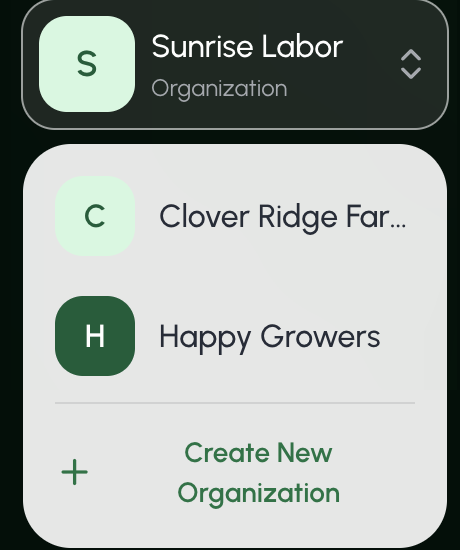

3. Enter the new organization's name, employee size, and primary use case. Then select **Next Step**.

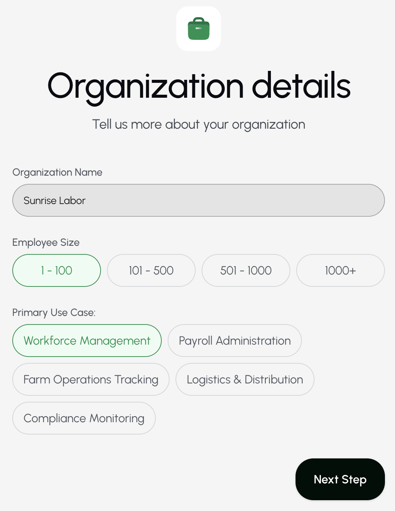

4. Select the organization's pay frequency, cycle start day, and cycle end day. Then select **Next Step**.
   - This step is optional. You may also select **Skip for now**.

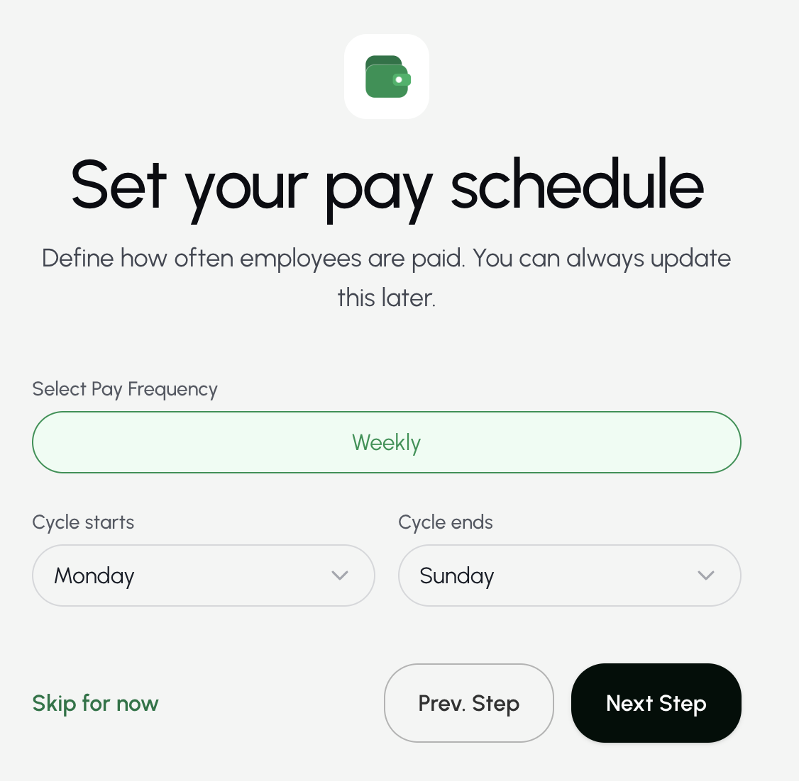

5. [Create a crew](/Employees-and-Crews#id1). Then select **Proceed**.
   - This step is optional. You may also select **Skip for now**.

Farmio opens the dashboard for your new organization.

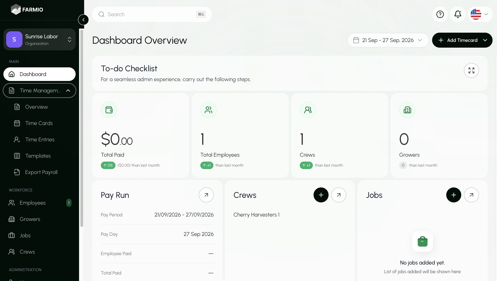

---

### View all organizations

Select the organization that you currently have open in the sidebar. Your organizations appear in the dropdown menu.

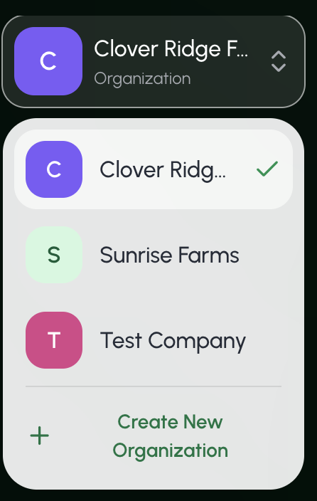

---

### Find an organization

Under **System Administration**, select **Manage Organizations**.

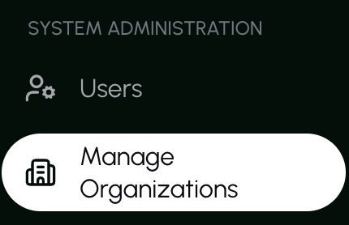

The page lists the organizations you’re connected to.

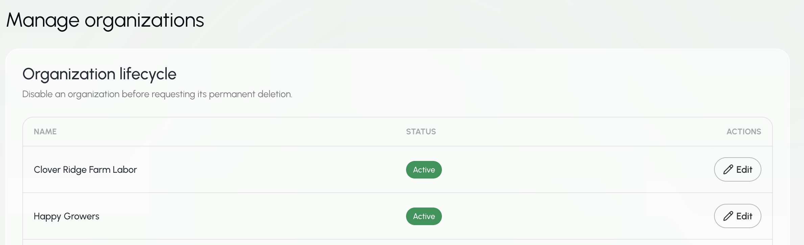

---

### View organization details

Under **Organization**, select **Configuration**.

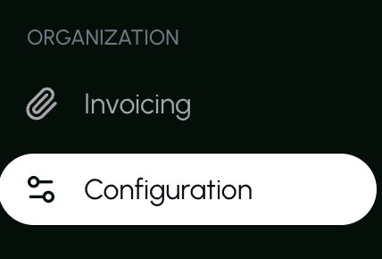

Here you can view the organization's name, employee size, primary use case, and pay schedule.

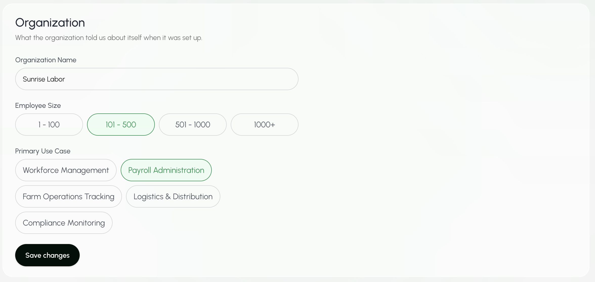

---

### Update organization details

1. Under **Organization**, select **Configuration**.

2. Edit the organization's name, employee size, primary use case, or pay schedule.

3. Select **Save changes**.

---

## B. Organization Settings

### View organization settings

Under **Organization**, select **Configuration**.

The Configuration page includes these sections.

**Organization details**

**Pay schedule**

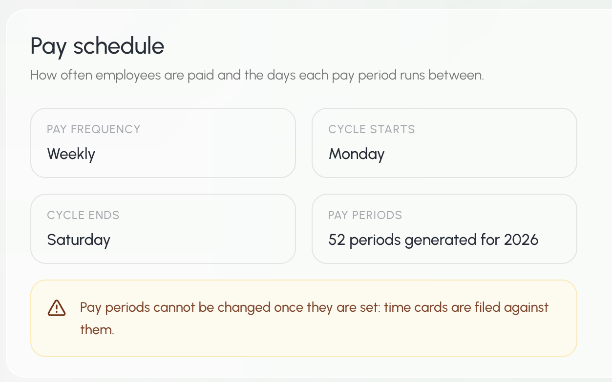

**Payroll (minimum wage)**

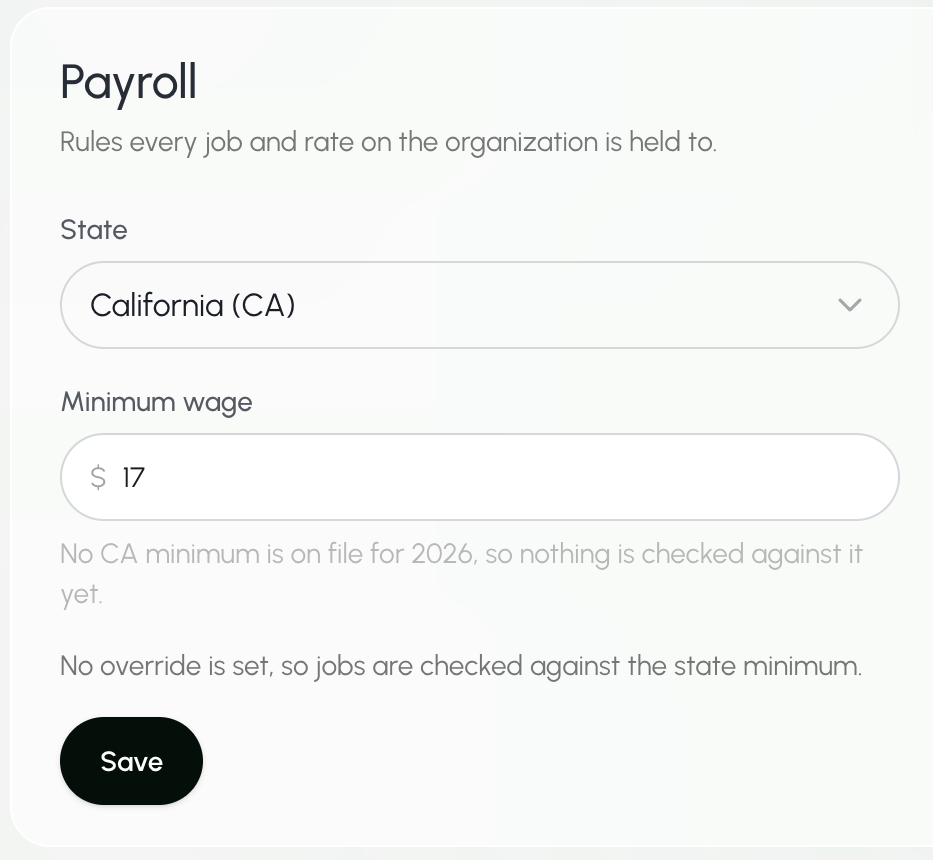

**Pay codes**

_Pay codes are automatically set to the DataTech default._

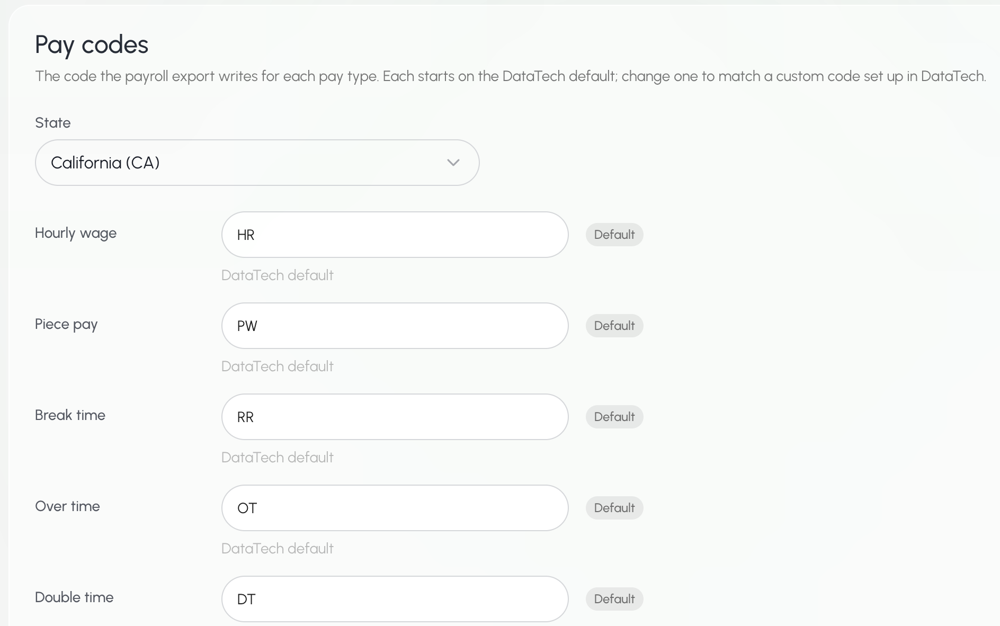

**Employee roles**

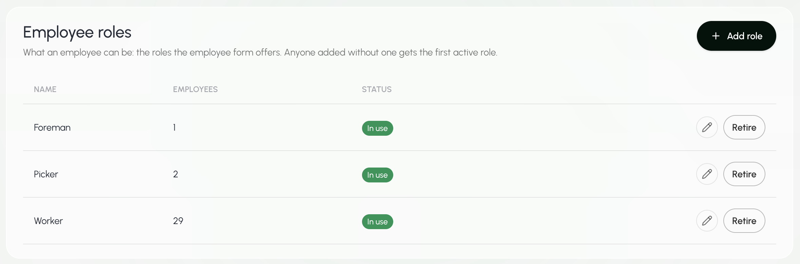

**Units**

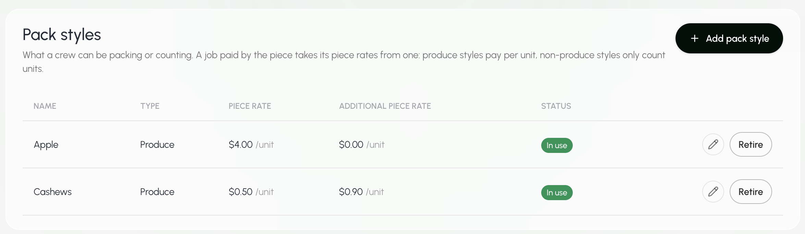

---

### Update organization pay codes

1. Under **Organization**, select **Configuration**.

2. Scroll down to **Pay codes**.

3. Update the pay code.

4. Select **Save changes**.

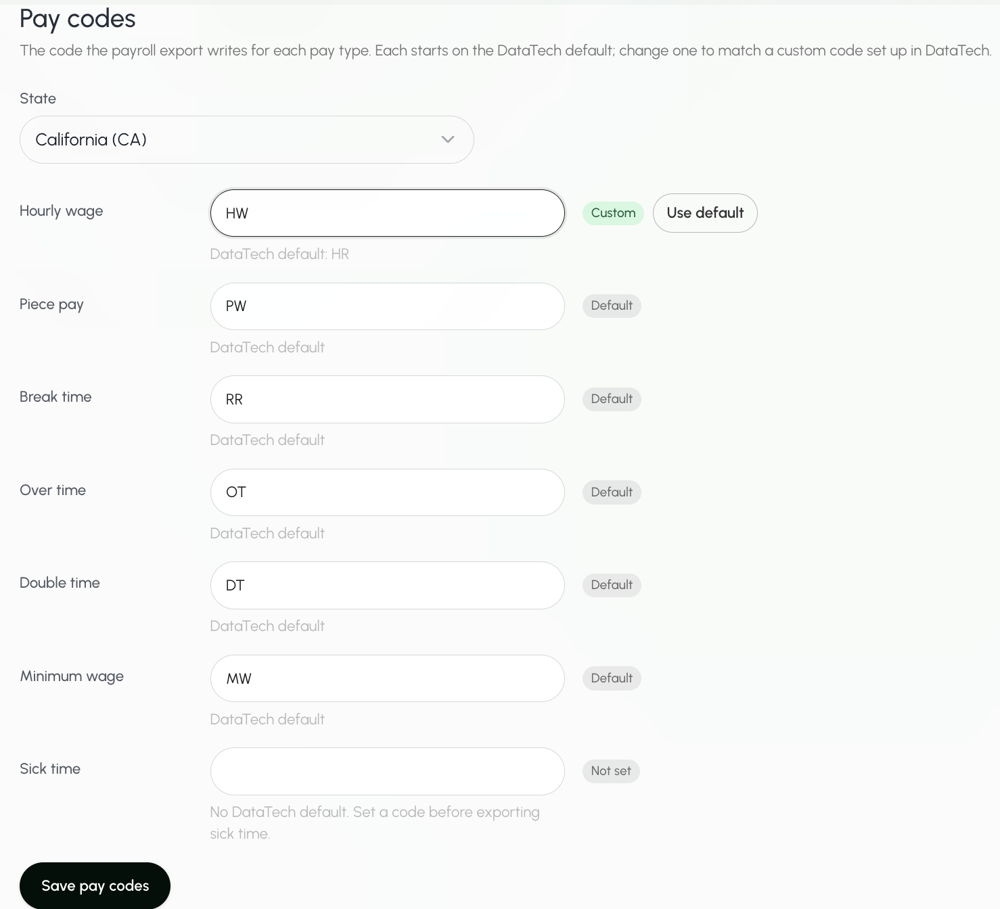

_To restore the system default, select **Use default**._

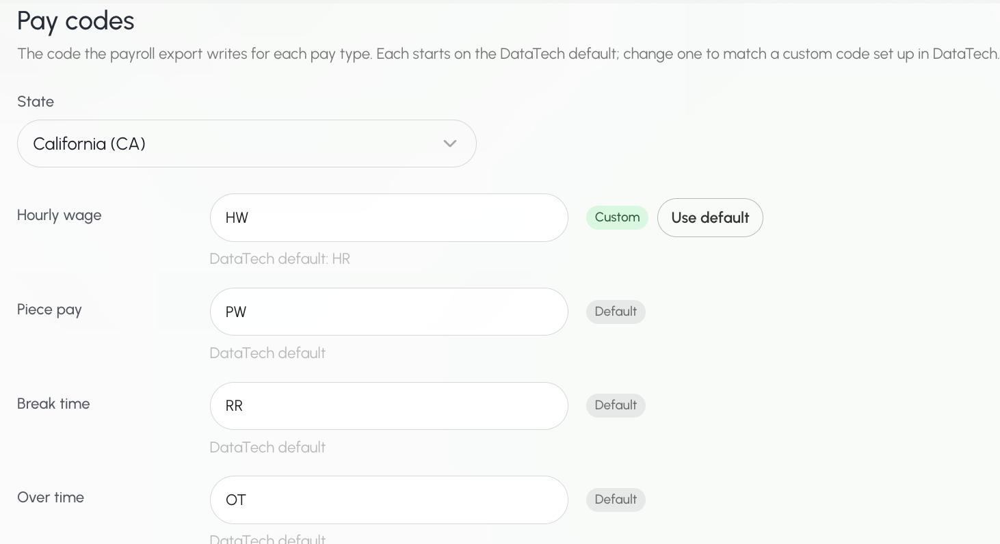
