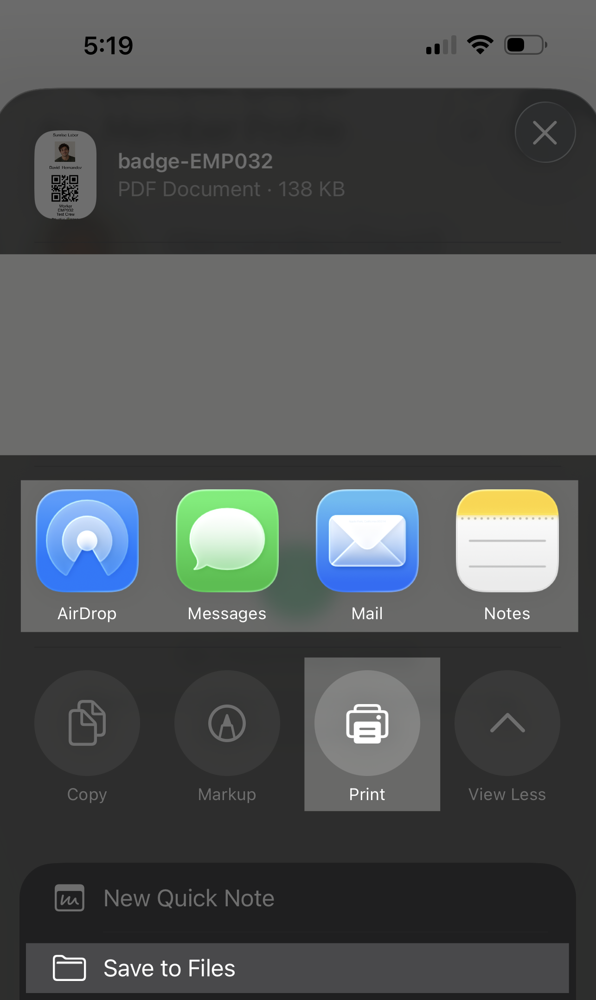

## Quickstart Guide

### Find a timecard

Any time cards scheduled for that day will show on the **Home Page**. 

**You can also find time cards for the current pay period:**

1. Select the **Timecard** page  from the bottom menu.

2. You can search for a specific time card by selecting a date and/or crew. 

<Info>
  The mobile app only shows time cards for the current pay period. You can find a timecard for any pay period in the [web version](#va4).
</Info>

---

### Export an employee badge

1. Select the **Crew** page  from the bottom menu.

2. Select the **Search** box above the employee list.
3. Enter the employee's first name, last name, or Employee ID.
4. Select the employee you want to update.

5. Select the **export** button  in the top right of the page.

You can save, share, or print the employee badge.

---

### Clock employees in

1. Select the **Timecard** page  from the bottom menu.

2. Find and select the timecard you want to clock employees in for.

3. Under **Timecard tasks**, select **Scan now** in the **Clock In Members** section.

4. Select **Scan per group** or **Scan per individual**.

- **Scan per group**: assign members to a group for the current time card.
- **Scan per individual**: scan in employees without creating groups for the current time card.

5. Scan the QR codes on each employee's badge.

- The employee names will show up under **Selected Members** as they are successfully scanned.

6. Select **Clock In Members**. 

A **confirmation screen** appears, showing the number of employees successfully clocked in and the timecard number.

---

### Record employee breaks

1. Select the **Timecard** page  from the bottom menu.

2. Find and select the timecard you want to record a break for.

3. Select **Morning Break**, **Lunch Beak**, or **Afternoon Break** to open the timecard task.
4. Select **Scan now** for the break you want to record.

5. Select **Scan per group** or **Scan per individual**.

- **Scan per group**: assign members to a group for the current time card.
- **Scan per individual**: scan in employees without creating groups for the current time card.

6. Scan the QR codes on each employee's badge.

- The employee names will show up under **Selected Members** as they are successfully scanned.

7. Select **Clock In Members**. 
   1. A  **confirmation screen** appears, showing that the break has started.

8. When the employee breaks are over, select **Scan now** for the break you want to end.

9. Select the **Scan** button  at the bottom right of the page.

10. Select **Scan per group** or **Scan per individual**.
11. Scan the QR codes on each employee's badge.

- The employee names will show up under **Selected Members** as they are successfully scanned.
  

12. Select **Clock In Members**. 
    1. A **confirmation screen** appears, showing that the break has ended.
    2. You can **skip any breaks** that do not apply to the workday.
       

---

### Clock employees out

1. Select the **Timecard** page  from the bottom menu.

2. Find and select the timecard you want to clock employees out for.

3. Select **Clock Out Members** to open the timecard task.

4. Select **Scan now**.
5. Select **Scan per group** or **Scan per individual**.

- **Scan per group**: assign members to a group for the current time card.
- **Scan per individual**: scan in employees without creating groups for the current time card.

6. Scan the QR codes on each employee's badge.
   - The employee names will show up under **Selected Members** as they are successfully scanned.
7. Select **Clock Out Members**.

8. Confirm your changes by selecting **Confirm & Submit**.
9. A **confirmation screen** appears, showing the number of employees successfully clocked out and the timecard number.

Once all employees are clocked out, the timecard status will change to **Submitted**.

---

## Employees & Crews

### Add one employee

1. Select the **Crew** page  from the bottom menu.

2. Select the + button in the top right of the page.

3. Enter the employee's first name, last name, and employee ID.\*

_\*Optional: Add a custom pay rate for the employee._

4. Select **Create Member** to save your new employee.

---

### Update employee details

1. Select the **Crew** page  from the bottom menu.

2. Select the **Search** box above the employee list.
3. Enter the employee's first name, last name, or Employee ID.
4. Select the employee you want to update.

5. Select the edit button  on the employee's profile.

6. Update the employee's first name, last name, employee ID, custom rate, member status, or profile picture.
7. Select **Update Profile** to save your changes.

---

### Export an employee badge

1. Select the **Crew** page  from the bottom menu.

2. Select the **Search** box above the employee list.
3. Enter the employee's first name, last name, or Employee ID.
4. Select the employee you want to update.

5. Select the **export** button  in the top right of the page.

You can save, share, or print the employee badge.

---

### Find an employee's current hourly rate

Select the **Crew** page  from the bottom menu.

2. Select the **Search** box above the employee list.
3. Enter the employee's first name, last name, or Employee ID.
4. Select the employee you want to update.

The employee's hourly rate is listed next to the Employee ID.

---

### View all employee roles

[Add documentation here.]

---

### View all crews

1. Select the **Crew** page  from the bottom menu.

2. Select the **All Crews** dropdown list.

All crews linked to this user are listed.

---

## Ranches & Locations

### View all ranches by grower

1. On the **Home Page**, select **Create time card**.

2. Select the **Grower** from the dropdown menu.

3. Select the **Ranch** dropdown menu to see all ranches for that grower.

---

### View locations by ranch

1. On the **Home Page**, select **Create time card**.

2. Select the **Grower** from the dropdown menu. 

3. Select the **Ranch** from the dropdown menu. 

4. Select the **Location** dropdown menu to see all locations for that ranch.

---

## Pay Periods & Jobs

### View organization pay periods

1. On the **Home Page**, select **View all** under **Pending Approval**.

2. Select the **Period** at the top of the page.
   

This is the list of all of the pay periods for the calendar year.

---

### View all active jobs for an organization

On the **Home Page**, select **Create time card**.

2. Select the **Grower** from the dropdown menu. 

3. Select the **Ranch** from the dropdown menu. 

4. Select the **Location** from the dropdown menu. 

5. Select the **Job** dropdown menu to see all active jobs in the organization.

---

## Creating & Viewing Time Cards

### Create a new time card for today

On the **Home Page**, select **Create time card**.

_If you already have active time cards for today, you can go to the **Timecard** page_  _from the bottom menu and select the add **\+** button._ 

2. Select the crew, grower, ranch, location, and job.
3. Select **Create Timecard** to saver your new timecard.

This timecard will now be available on your **Home Page** and on your **Time Card** page. 

---

### View all timecards for an organization in a pay period

1. On the **Home Page**, select **View all** under **Pending Approval**.

2. Select the **Period** at the top of the page.
   

This is the list of all of the pay periods for the calendar year.

1. On the **Home Page**, select **View all** under **Pending Approval**.

2. Select the **Period** at the top of the page.
   
3. Select the pay period you want to view. 

4. This is the list of all of the time cards within this pay period.

---

### Find a time card

Any time cards scheduled for that day will show on the **Home Page**. 

**You can also find time cards for the current pay period:**

1. Select the **Timecard** page  from the bottom menu.

2. You can search for a specific time card by selecting a date and/or crew. 

<Info>
  The mobile app only shows time cards for the current pay period. You can find a timecard for any pay period in the [web version](#va4).
</Info>

---

## Editing & Managing Active Time Cards

### Clock employees in

1. Select the **Timecard** page  from the bottom menu.

2. Find and select the timecard you want to clock employees in for.

3. Under **Timecard tasks**, select **Scan now** in the **Clock In Members** section.

4. Select **Scan per group** or **Scan per individual**.

- **Scan per group**: assign members to a group for the current time card.
- **Scan per individual**: scan in employees without creating groups for the current time card.

5. Scan the QR codes on each employee's badge.

- The employee names will show up under **Selected Members** as they are successfully scanned.

6. Select **Clock In Members**. 

A **confirmation screen** appears, showing the number of employees successfully clocked in and the timecard number.

---

### Record employee breaks

1. Select the **Timecard** page  from the bottom menu.

2. Find and select the timecard you want to record a break for.

3. Select **Morning Break**, **Lunch Beak**, or **Afternoon Break** to open the timecard task.
4. Select **Scan now** for the break you want to record.

5. Select **Scan per group** or **Scan per individual**.

- **Scan per group**: assign members to a group for the current time card.
- **Scan per individual**: scan in employees without creating groups for the current time card.

6. Scan the QR codes on each employee's badge.

- The employee names will show up under **Selected Members** as they are successfully scanned.

7. Select **Clock In Members**. 
   1. A  **confirmation screen** appears, showing that the break has started.

8. When the employee breaks are over, select **Scan now** for the break you want to end.

9. Select the **Scan** button  at the bottom right of the page.

10. Select **Scan per group** or **Scan per individual**.
11. Scan the QR codes on each employee's badge.

- The employee names will show up under **Selected Members** as they are successfully scanned.
  

12. Select **Clock In Members**. 
    1. A **confirmation screen** appears, showing that the break has ended.
    2. You can **skip any breaks** that do not apply to the workday.
       

---

### Clock employees out

1. Select the **Timecard** page  from the bottom menu.

2. Find and select the timecard you want to clock employees out for.

3. Select **Clock Out Members** to open the timecard task.

4. Select **Scan now**.
5. Select **Scan per group** or **Scan per individual**.

- **Scan per group**: assign members to a group for the current time card.
- **Scan per individual**: scan in employees without creating groups for the current time card.

6. Scan the QR codes on each employee's badge.
   - The employee names will show up under **Selected Members** as they are successfully scanned.
7. Select **Clock Out Members**.

8. Confirm your changes by selecting **Confirm & Submit**.
9. A **confirmation screen** appears, showing the number of employees successfully clocked out and the timecard number.

Once all employees are clocked out, the timecard status will change to **Submitted**.

---

### View all employees in an active time card

1. Select the **Timecard** page  from the bottom menu.

2. Find and select the timecard you want to view all employees for.

2. Select the **employees** button  at the top right of the timecard page. 

4. All employees on the timecard are listed under **Members**.

---

### Move employees to a different job in a time card 

1. Select the **Timecard** page  from the bottom menu.

2. Find and select the timecard you want to move employees for.

3. The **Move Members** button will not work until the employee's lunch break has started.
   
4. Once the employee's lunch break starts, you can select **Move Members.**

3. Select the ranch, location, and job that you want to move the employee to. 
4. Select **Proceed**.

7. Select the employee(s) you would like to move.
8. Select **Move Selected**.

9. Confirm the move by selecting **Submit**.

You will receive a confirmation of your changes. 

The time card will now show the new clocking event. 

---

## Editing & Managing Completed Time Cards

### View all employees in a completed time card

1. On the **Home Page**, select **View all** under **Pending Approval**.

2. Select the **Period** at the top of the page.
   
3. Select the time card you want to view.
   
4. Select the edit button.

5. Select **Manage employees**.

6. All employees currently on the timecard are listed under **Employees in the Timecard**.

---

### Add employees to a completed time card

1. On the **Home Page**, select **View all** under **Pending Approval**.

2. Select the **Period** at the top of the page.
   
3. Select the time card you want to edit.
   
4. Select the edit button.

5. Select **Manage employees**.

6. Select **Scan to add employees.** 

7. Scan the employee's badge to add the employee to the timecard.

---

### Remove employees from a completed time card

1. On the **Home Page**, select **View all** under **Pending Approval**.

2. Select the **Period** at the top of the page.
   
3. Select the time card you want to edit.
   
4. Select the edit button.

5. Select **Manage employees**.

6. Select the **delete** button next to the employee that you want to remove. 
7. Confirm your deletion to remove the employee.

---

### View eligible employees for a completed time card

1. On the **Home Page**, select **View all** under **Pending Approval**.

2. Select the **Period** at the top of the page.
   
3. Select the time card you want to view.
   
4. Select the edit button.

5. Select **Manage employees**.

6. All employees that can be added the timecard are listed under **Employees to add**.

---

### Update time card status

[enter documentation here.]

---

## Managing Time Card Status & Breaks

### Add break to a completed time card

1. On the **Home Page**, select **View all** under **Pending Approval**.

2. Select the **Period** at the top of the page.
   
3. Select the time card you want to view.
   
4. Select the edit button.

5. Select **Add Breaks**.

6. Select the **Break Start** and **Break End**.

Select **Add 1 Break** to save your break to the time card.

You can now view the new break under **Breaks**.

---

### View breaks in a completed time card

1. On the **Home Page**, select **View all** under **Pending Approval**.

2. Select the **Period** at the top of the page.
   
3. Select the time card you want to view.
   
4. Select the edit button.

You can now view the break under **Breaks**.

---

### Delete break from a completed time card

1. On the **Home Page**, select **View all** under **Pending Approval**.

2. Select the **Period** at the top of the page.
   
3. Select the time card you want to view.
   
4. Select the edit button.

5. Select the delete icon next to the break you want to delete.
   
6. Select **Delete** to confirm this action.
   

This break should no longer be listed under **Breaks**.

